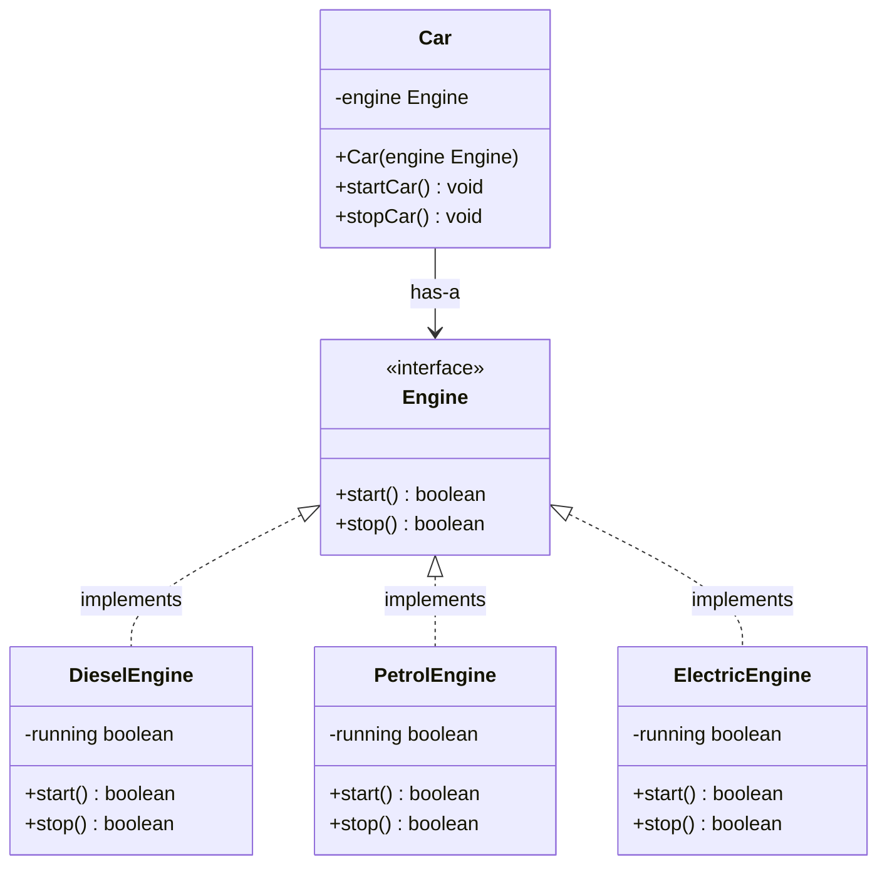

# Phase 8 — Lesson 13: UML Class Diagram & Object Relationships

## Goal

Use a UML class diagram to visualize the Car System's classes, their members, and the relationships between them before or during implementation.

## 1. What Is UML?

UML stands for **Unified Modeling Language**.

It is a visual modeling language that helps describe:

- Which classes and interfaces exist in a system.
- Which attributes and methods belong to each class.
- How classes and interfaces relate to one another.

A UML class diagram provides a useful design view before implementation.

## 2. Car System UML Class Diagram

The following conceptual diagram shows the Engine interface, its implementations, and the Car relationship:



**Notation note:** The diagram is conceptual and focuses on the design relationships. The Engine interface is implemented by the three concrete engine classes. Car holds an Engine reference supplied through its constructor. The association shown from Car to Engine represents the HAS-A relationship; strict UML composition is normally shown with a filled diamond and implies stronger lifecycle ownership.

## 3. UML Symbols

| Symbol | Meaning |
|---|---|
| `+` | Public |
| `-` | Private |
| `#` | Protected |
| `()` | Method or operation |
| `:` | Separates a member name from its type, or an operation from its return type |

For example, Java code:

```java
private boolean running;
public boolean start();
```

is represented in UML as:

```text
- running: boolean
+ start(): boolean
```

## 4. Important Object Relationships

### A. Interface Realization / Implementation

`DieselEngine implements Engine`

DieselEngine provides implementations of the operations declared by the Engine interface. PetrolEngine and ElectricEngine have the same relationship.

### B. HAS-A Relationship

`Car` has an `Engine` reference:

```java
private final Engine engine;
```

Car delegates engine operations through this reference.

**UML precision:** A field reference establishes an association. Composition is a stronger whole-part relationship, conventionally drawn with a filled diamond. In this learning model, the engine is created outside Car and injected through its constructor, so the relationship is more accurately described as an association/HAS-A relationship rather than strict lifecycle-owning composition.

### C. Dependency Injection

```java
Car(Engine engine)
```

The constructor receives the Engine dependency from the caller. In a UML class diagram, this can be shown as a public constructor operation:

```text
+ Car(engine: Engine)
```

The `engine` parameter has type `Engine`.

## 5. Practice — UML Understanding

Answer these questions to check your understanding:

1. In UML, what does `- running: boolean` mean?
2. In `+ start(): boolean`, what does `boolean` represent?
3. What relationship exists between DieselEngine and Engine?
4. What relationship exists between Car and Engine?
5. How would you represent the `Car(Engine engine)` constructor in UML?

## 6. Quick Revision Checklist

- [ ] Identify the Engine interface in the class diagram.
- [ ] Identify the three concrete engine implementations.
- [ ] Read public, private, and protected visibility symbols.
- [ ] Distinguish attributes from operations.
- [ ] Identify interface implementation (realization).
- [ ] Identify the Car-to-Engine HAS-A association.
- [ ] Represent the constructor parameter using the Engine type.

## Key Takeaway

**UML makes class structure and relationships visible before implementation. It helps communicate design decisions, but the diagram should use relationship notation that accurately reflects the code.**
